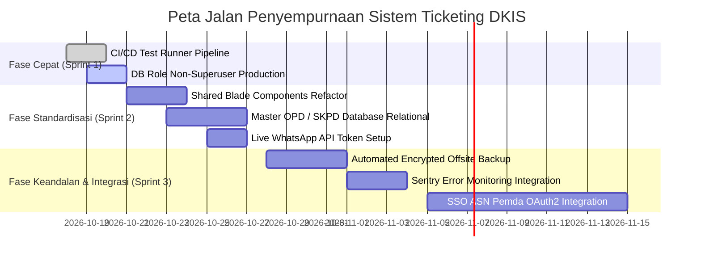

# REKOMENDASI STRATEGIS PENGEMBANGAN SISTEM TICKETING DKIS (FASE 6)

**Tanggal:** 17 Oktober 2026  
**Dokumen Acuan:** `audit sistem.md` (FASE 6)  
**Tujuan:** Peta jalan strategis jangka pendek, menengah, dan panjang untuk keandalan arsitektur, keamanan siber, dan operasional layanan publik.

---

## 1. Ringkasan Eksekutif 5 Baris
1. Audit dan perbaikan sistem ticketing telah berhasil mengamankan celah kritis publik, menutup kebocoran berkas, dan menstabilkan alur penugasan teknisi.
2. Rekomendasi strategis ini disusun berdasarkan matriks dampak nilai bisnis versus tingkat usaha (*Value vs Effort Matrix*).
3. Prioritas utama jangka pendek difokuskan pada pemisahan hak akses superuser basis data pada deployment produksi dan otomatisasi pipeline CI/CD pengujian.
4. Prioritas jangka menengah berfokus pada standardisasi master SKPD/OPD dan integrasi Single Sign-On (SSO) ASN Kota Cirebon.
5. Prioritas jangka panjang diarahkan pada integrasi pemantauan observabilitas (APM & Sentry) serta otomasi cadangan data (*automated offsite backup*).

---

## 2. Matriks Rekomendasi Strategis (Diurutkan Berdasarkan Nilai & Usaha)

| No | Rekomendasi Strategis | Kategori | Nilai (Impact) | Usaha (Effort) | Rasio Prioritas | Alasan Singkat & Rencana Implementasi |
| :---: | :--- | :--- | :---: | :---: | :---: | :--- |
| **1** | **Automated CI/CD Pipeline Test Runner** | Pengujian & QA | ⭐⭐⭐⭐⭐ Sangat Tinggi | 🟢 Rendah (1-2 hari) | **P1 (Segera)** | Jalankan seluruh 25 unit & feature test secara otomatis via GitHub Actions / GitLab CI pada setiap pull request untuk mencegah regresi kode di masa mendatang. |
| **2** | **Pemisahan Kredensial Database Non-Superuser** | Keamanan (SEC-03) | ⭐⭐⭐⭐⭐ Sangat Tinggi | 🟢 Rendah (1 hari) | **P1 (Segera)** | Buat role `ticketing_app` di PostgreSQL dengan hak terbatas `SELECT, INSERT, UPDATE, DELETE` pada skema `public`, menanggalkan pemakaian user `postgres` di server produksi. |
| **3** | **Ekstraksi Komponen Blade Bersama (*Shared Components*)** | Arsitektur UI | ⭐⭐⭐⭐ Tinggi | 🟡 Sedang (2 hari) | **P2 (Jangka Pendek)** | Pindahkan badge status tiket, level TLP, countdown SLA, dan modal popup ke `resources/views/components/` untuk konsistensi antarmuka 100%. |
| **4** | **Master Tabel SKPD / OPD Kota Cirebon** | Kualitas Data (PERF-03)| ⭐⭐⭐⭐ Tinggi | 🟡 Sedang (2-3 hari) | **P2 (Jangka Pendek)** | Ganti kolom teks bebas `skpd` dengan tabel master relasional `skpd_id` untuk mencegah duplikasi nama ("Dinkes", "Dinas Kesehatan") pada laporan analitik. |
| **5** | **Integrasi Live WhatsApp Gateway Provider** | Operasional (NOTIF-01) | ⭐⭐⭐⭐⭐ Sangat Tinggi | 🟢 Rendah (1 hari) | **P2 (Jangka Pendek)** | Masukkan kredensial API gateway resmi (Fonnte/Wablas) ke `.env` produksi untuk mengaktifkan pengiriman notifikasi instan langsung ke WhatsApp ASN pelapor dan teknisi. |
| **6** | **Integrasi Single Sign-On (SSO) ASN Kota Cirebon** | Akses & Keamanan | ⭐⭐⭐⭐⭐ Sangat Tinggi | 🔴 Tinggi (1-2 minggu) | **P3 (Jangka Menengah)** | Hubungkan autentikasi pelapor dan admin dengan portal SSO Kepegawaian (BKPSDM) Kota Cirebon via OAuth2 / SAML2 untuk otentikasi biometrik/SIAK. |
| **7** | **Otomatisasi Backup Basis Data Berkala (Off-Site Backup)** | Keandalan (Disaster Recovery) | ⭐⭐⭐⭐⭐ Sangat Tinggi | 🟡 Sedang (2-3 hari) | **P3 (Jangka Menengah)** | Pasang cron job harian pengeksekusi `pg_dump` dengan enkripsi GPG dan sinkronisasi ke storage cloud terisolasi (S3/MinIO) terpisah dari server web. |
| **8** | **Observabilitas & APM (Error Tracking Sentry / Prometheus)** | Pemantauan Sistem | ⭐⭐⭐⭐ Tinggi | 🟡 Sedang (3 hari) | **P4 (Jangka Panjang)** | Pasang Sentry SDK pada Laravel untuk menangkap exception real-time di lingkungan staging/produksi sebelum dilaporkan oleh pengguna. |

---

## 3. Peta Jalan Pelaksanaan (Roadmap)

---

## 4. Catatan Keterbatasan & Hal yang Perlu Keputusan Pimpinan
1. **Penyelarasan Kebijakan Master OPD**: Penataan master SKPD memerlukan koordinasi daftar resmi nomenklatur dinas, badan, dan kecamatan di lingkungan Pemerintah Kota Cirebon.
2. **Ketersediaan Kuota WhatsApp Gateway**: Pengadaan kuota pesan resmi WhatsApp Business API untuk pengiriman notifikasi pengaduan masyarakat/ASN.
