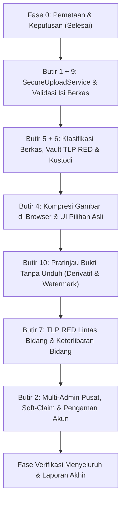

# Rencana Kerja Pelaksanaan Revisi Sistem Ticketing
**Sistem Ticketing DKIS Kota Cirebon**  
**Tanggal**: 21 Oktober 2026  
**Status**: DIJALANKAN BERURUTAN (1+9, 5+6, 4, 10, 7, 2)

---

## Urutan dan Tahapan Implementasi

Sesuai urutan yang ditentukan pada `revisi.md`:

### 1. Butir 1 + 9: Pemeriksaan Jenis dan Isi Berkas di Semua Titik Unggah
- [ ] Buat file konfigurasi `config/files.php` yang memuat allowlist per konteks, batas ukuran, durasi video, dan pengaturan keamanan berkas.
- [ ] Buat migrasi baru aditif: menambahkan kolom `sha256`, `original_name`, `classification`, `is_encrypted`, `vault_path` pada tabel `ticket_files` (dan kolom terkait pada `tickets` jika diperlukan).
- [ ] Buat `SecureUploadService` di `app/Services/SecureUploadService.php`:
  - Validasi magic bytes & MIME via finfo.
  - Sanitasi & re-encode gambar via GD (membersihkan EXIF, GPS, steganografi/payload).
  - Validasi struktur PDF (header `%PDF-`, deteksi dan penolakan `/JavaScript`, `/JS`, `/Launch`, `/OpenAction`, lampiran tertanam).
  - Validasi berkas teks/log murni UTF-8 tanpa karakter biner terlarang.
  - Validasi video MP4 (header container `ftyp`, batas ukuran & durasi).
  - Sanitasi nama berkas: tolak ekstensi ganda, byte null, karakter kontrol, path traversal. Simpan berkas dengan nama acak UUID.
  - Hitung dan catat SHA-256 hash saat unggah.
  - Antarmuka antivirus (`VirusScannerInterface`).
- [ ] Perbarui semua controller untuk memanggil `SecureUploadService` dan hapus semua pemanggilan `->store()` langsung.
- [ ] Buat perintah artisan `php artisan files:rescan-security` untuk memindai ulang berkas yang sudah tersimpan tanpa menghapus berkas fisik.
- [ ] Tulis unit & feature test untuk memastikan penolakan sampel berkas berbahaya/disamarkan dan kelolosan berkas sah.

### 2. Butir 5 + 6: Perlakuan Berkas untuk TLP RED dan Berkas Rahasia
- [ ] Tambahkan disk `vault` dan `previews` pada `config/filesystems.php`.
- [ ] Implementasikan enkripsi berkas di vault (`VaultStorageService` atau integrasi di `SecureUploadService`) menggunakan kunci tersendiri `VAULT_ENCRYPTION_KEY`.
- [ ] Buat migrasi tabel `ticket_file_access_requests` untuk permohonan akses berkas rahasia oleh Admin Pusat.
- [ ] Saat tiket menjadi TLP RED (atau dibuat sebagai RED), otomatis pindahkan berkas lampiran ke disk `vault` dan enkripsi at-rest.
- [ ] Batasi akses berkas rahasia/RED: hanya Admin Bidang Persandian dan Teknisi Persandian tertunjuk. Admin Pusat hanya melihat metadata dan tombol "Minta Akses". Bidang ditembuskan tidak melihat berkas atau pratinjau.
- [ ] Implementasikan download via URL bertanda tangan berumur pendek (maks. 5 menit) dan catat jejak kustodi digital di `audit_log`.

### 3. Butir 4: Kompresi Gambar Otomatis Sebelum Unggah di Browser
- [ ] Buat modul JavaScript mandiri (HTML5 Canvas) di public assets / Blade template yang melakukan kompresi adaptif (max 1920px, kualitas adaptif ~1MB, strip EXIF).
- [ ] Sediakan UI pratinjau sebelum unggah, indikator ukuran asli vs ukuran terkompresi, dan progress bar.
- [ ] Sediakan opsi checkbox *"Unggah berkas asli tanpa kompresi"* untuk kategori insiden/TLP RED.

### 4. Butir 10: Pratinjau Bukti Tanpa Unduh
- [ ] Buat service / queue job `GenerateFilePreviewJob` untuk membuat turunan aman di disk `previews`:
  - Gambar: WebP/JPEG max 1600px + thumbnail.
  - PDF: Rasterisasi halaman ke gambar (halaman 1 s/d 10).
  - Video: Cuplikan poster & transcode ringan MP4 streaming.
  - Teks/Log: Escape HTML, blok kode max 200 KB.
- [ ] Buat antarmuka galeri modal interaktif (zoom, pan, paging PDF, keyboard arrow & Esc).
- [ ] Watermark tipis untuk pratinjau berkas berklasifikasi rahasia.
- [ ] Endpoint `GET /tiket/{kode}/preview/{fileId}` dengan header `Content-Disposition: inline`, `X-Content-Type-Options: nosniff`, CSP ketat. Catat event `file_previewed` dengan rate limit/debounce.
- [ ] Perintah artisan `php artisan previews:rebuild`.

### 5. Butir 7: TLP RED Lintas Bidang
- [ ] Buat migrasi:
  - Tambah kolom `is_persandian` (boolean default false) pada tabel `bidang`.
  - Buat tabel `ticket_bidang_involvement` (`ticket_id`, `bidang_id`, `peran`, `notified_at`, `acknowledged_at`, `ditetapkan_oleh`).
- [ ] Perbarui logika disposisi: Tiket RED otomatis dan mutlak menetapkan Bidang Persandian sebagai pelaksana. Admin Pusat memilih bidang ditembuskan.
- [ ] Bidang ditembuskan hanya melihat ringkasan terbatas tanpa berkas atau pratinjau.
- [ ] Dukungan teknisi lintas bidang sebagai pendamping (disetujui admin bidang pemilik).
- [ ] Hapus semua pencocokan string `LIKE '%persandian%'`.

### 6. Butir 2: Dua Admin Pusat Sekaligus
- [ ] Buat migrasi:
  - Tambah kolom `claimed_by` (foreignId users nullable), `claimed_at` (timestamp nullable), `row_version` (integer default 1) pada tabel `tickets`.
- [ ] Implementasikan soft claim pada tiket di antrean verifikasi dengan kedaluwarsa otomatis 10 menit.
- [ ] Tambahkan tombol "Ambil Tiket Berikutnya" (atomic claim via `lockForUpdate`).
- [ ] Terapkan optimistic locking berbasis `row_version` (HTTP 409 Conflict jika ada perubahan bersamaan).
- [ ] Proteksi akun di `UserController`: larang menghapus atau menonaktifkan Admin Pusat terakhir dan akun diri sendiri.
- [ ] Tambahkan akun Admin Pusat kedua di seeder (`admin.pusat2@cirebonkota.go.id`).

### 7. Verifikasi, Uji Menyeluruh, dan Dokumentasi Akhir
- [ ] Jalankan seluruh rangkaian test baru dan lama.
- [ ] Buat dokumen `03-PERUBAHAN.md`, `04-VERIFIKASI.md`, `05-RINGKASAN.md`.
- [ ] Lanjutkan ke tahapan `AUDIT.md` (`laporan_audit.html`) dan `audit sistem.md` (`docs/audit/`).
